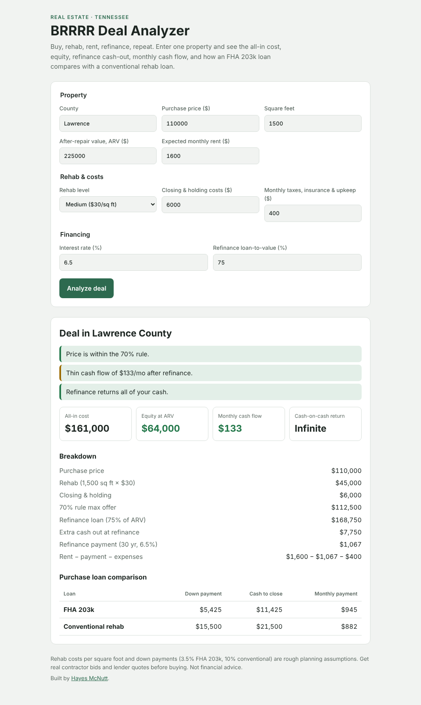

# TN BRRRR Deal Analyzer

A one-page calculator for **BRRRR** real estate deals: buy, rehab, rent, refinance, repeat. Enter one property and it shows whether the numbers work.

**Live demo:** https://hayescon412.github.io/deal-tracker/

## What it calculates
- **All-in cost:** purchase price + rehab + closing and holding costs
- **Rehab estimate:** square feet × $20 / $30 / $40 per sq ft for light, medium or full-gut rehab
- **Equity at ARV:** after-repair value minus all-in cost
- **70% rule check:** max offer = 70% of ARV − rehab
- **Refinance:** loan at your chosen loan-to-value, cash left in the deal or extra cash pulled out
- **Monthly cash flow:** rent − refinance payment − taxes, insurance and upkeep
- **Cash-on-cash return** on the cash left in the deal
- **Loan comparison:** FHA 203k (3.5% down) vs conventional rehab (10% down), with cash to close and monthly payment

Results come with a quick verdict, color-coded good / thin / bad.

## Tech
- Plain HTML, CSS and JavaScript with no build step or dependencies
- Light and dark mode follow your system setting
- Input validation with inline error messages

## Run it
Open `index.html` in a browser, or use the live demo.

## Disclaimer
Rehab costs and down payments are rough planning assumptions. Get real contractor bids and lender quotes before buying. Not financial advice.

## License
MIT
